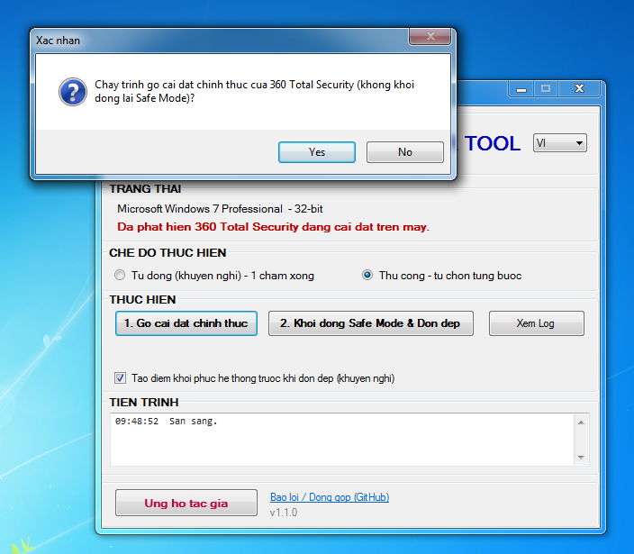
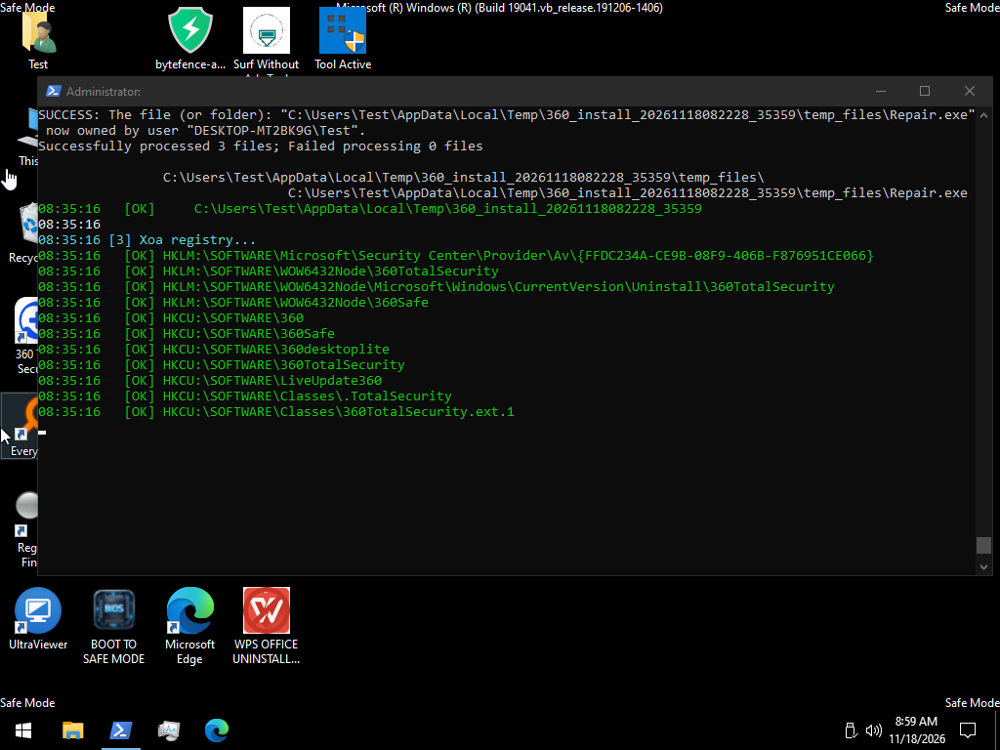
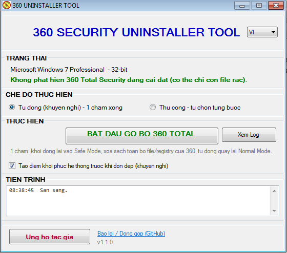

# 360 Security Uninstaller Tool

**A one-click tool that completely removes 360 Total Security — including all files, folders, services, and registry entries — by automatically rebooting into Safe Mode, cleaning everything, then rebooting back to Normal Mode.**

> Works on **Windows 7 (32/64-bit)** and **Windows 10/11 (64-bit)**. No manual steps required in Auto mode.

---

## Why This Tool Exists

360 Total Security installs kernel-level drivers and uses **Self-Protection** to block normal uninstallation attempts. Even after running its own uninstaller, registry keys and hidden folders remain. This tool bypasses Self-Protection entirely by running the cleanup in **Safe Mode**, where those drivers are inactive.

---

## Screenshots

### Tool detects 360 Total Security — ready to remove



### Cleanup running automatically in Safe Mode



### After cleanup — no 360 remnants found



---

## Features

- **One-click Auto mode** — boots Safe Mode, cleans everything, reboots back to Normal Mode automatically
- **Manual mode** — run the official uninstaller first, then do a deep Safe Mode cleanup pass
- **Kills 360 Self-Protection processes** on launch so the tool isn't blocked
- **Creates a System Restore Point** before cleaning (optional, recommended)
- **Full cleanup scope:**
  - Services and kernel drivers (`QHActiveDefense`, `360AvFlt`, `360netmon`, etc.)
  - Program folders (`C:\Program Files\360`, `C:\ProgramData\360Safe`, etc.)
  - All user AppData folders for all accounts on the machine
  - Registry keys (HKLM + HKCU, including WOW6432Node on 64-bit)
  - Shell context menu extensions (`SD360`)
  - Shortcuts, Start Menu entries, Desktop icons
  - Windows Firewall rules
  - MUI cache entries, pending rename operations
- **Real-time colored progress log** shown during cleanup
- **Auto-reboot back to Normal Mode** after cleanup (via `bcdedit /deletevalue safeboot`)
- **Idempotent** — safe to run multiple times; already-removed items are silently skipped
- **Vietnamese / English UI** (switch with the dropdown in the top-right corner)

---

## Requirements

- Windows 7 SP1 or later (32-bit or 64-bit)
- Administrator privileges (the tool auto-elevates via UAC)
- No .NET installation needed — uses .NET Framework 3.5 which is built into Windows

---

## Download

Download the latest `360 Uninstaller Tool.exe` from the [**Releases**](../../releases) page.

> Single `.exe` — no additional files needed. The cleanup scripts are embedded inside.

---

## How to Use

### Auto Mode (Recommended — one click)

This mode does everything automatically. You only need to log in after the Safe Mode reboot.

1. **Run** `360 Uninstaller Tool.exe` — it will request UAC elevation
2. Make sure **"Auto (recommended)"** is selected
3. Optionally check **"Create system restore point"** (recommended)
4. Click **"START REMOVING 360 TOTAL"**
5. Confirm the dialog
6. The PC will count down 10 seconds and **reboot into Safe Mode**
7. **Log in** to your Windows account in Safe Mode — cleanup starts automatically
8. A PowerShell window shows real-time progress (green = OK, red = failed)
9. After cleanup, the PC **reboots back to Normal Mode** automatically
10. Done — 360 Total Security is completely removed

### Manual Mode (Advanced)

Use this if you want to run 360's own uninstaller first before deep-cleaning remnants.

1. Run the tool and select **"Manual"** mode
2. Click **"1. Run official uninstaller"** — this launches 360's built-in uninstaller
3. After the official uninstaller finishes, click **"2. Boot Safe Mode & Clean"**
4. Follow steps 6–10 from Auto mode above

### Checking the Log

Click **"View Log"** at any time to open `C:\360_removal_log.txt` — it records every action taken (what was deleted, what was not found, bcdedit result, timestamps).

---

## How It Works (Technical)

```
Normal Mode
    │
    ├─ Kill 360 Self-Protection processes (QHActiveDefense, QHSafeTray, 360Tray, etc.)
    ├─ Copy cleanup script to C:\360_phase2_cleanup.ps1
    ├─ Register RunOnce entry *360Remover (fires even in Safe Mode, via .NET Registry API
    │   to handle the literal * in the key name — PowerShell wildcards would break this)
    ├─ Copy bat launcher to Startup folder (fallback if RunOnce doesn't fire)
    └─ bcdedit /set safeboot minimal → reboot
                │
                ▼
         Safe Mode Boot
                │
    ├─ RunOnce fires: launches 360_run_cleanup.bat → powershell 2_cleanup_360.ps1
    ├─ Script self-elevates to Admin via UAC if needed (Startup folder runs as user)
    ├─ [1] Stop & delete services / kernel drivers
    ├─ [2] Delete all 360 folders (uses takeown + icacls + robocopy MIR to bypass locks)
    ├─ [3] Delete registry keys (HKLM + HKCU, WOW6432Node, MuiCache, shell extensions)
    ├─ [4] Delete Firewall rules
    ├─ [5] Delete shortcuts and Start Menu entries
    ├─ [6] Clean up RunOnce entry, Startup bat, temp files
    └─ bcdedit /deletevalue safeboot → reboot to Normal Mode
```

**Key technical details:**
- Uses `.NET Registry.SetValue()` directly for the `*360Remover` RunOnce entry — PowerShell's registry provider treats `*` as a wildcard, which would prevent writing/reading the key
- Uses `-LiteralPath` for all `Test-Path`/`Remove-Item` calls on paths containing `*` (e.g. `HKLM:\SOFTWARE\Classes\*\shellex\...`) — without this, PowerShell enumerates thousands of keys and hangs for 6+ minutes
- Uses `robocopy /MIR` to empty locked directories before `Remove-Item` — handles files locked by kernel drivers
- PS 2.0 compatible throughout (Windows 7 ships with PowerShell 2.0)

---

## Supported Windows Versions

| Windows | Architecture | Tested |
|---------|-------------|--------|
| Windows 7 SP1 | 32-bit | Yes |
| Windows 7 SP1 | 64-bit | Yes |
| Windows 10 | 64-bit | Yes |
| Windows 11 | 64-bit | Expected to work |

---

## Notes

- **BitLocker**: If your drive is BitLocker-encrypted, booting into Safe Mode may require your recovery key. Have it ready.
- **Domain computers**: If the machine is domain-joined and your account requires network authentication, you may need to use a local admin account in Safe Mode.
- **Multiple users**: The tool cleans AppData for all user accounts found under `C:\Users\`.
- **Running twice**: Safe to run again after a reboot — the tool detects and skips already-removed items.

---

## License

[MIT License](LICENSE)

---

## Support

Found a bug or want to contribute? Open an issue on [GitHub](https://github.com/thanhitma9x/360-Security-Uninstaller-Tool/issues).
